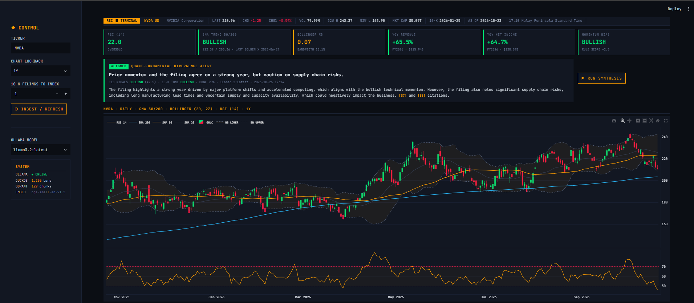

# Retail Stock Copilot & Synthesizer

A free, fully local stock-analysis workspace for retail investors.

It puts two views of a stock side by side:

- **Quantitative:** technical indicators and fundamentals computed with SQL window functions in DuckDB.
- **Qualitative:** what the company actually disclosed in its latest 10-K, retrieved by vector search in Qdrant and summarised by a local LLM through Ollama.

It then flags whether price momentum and the filing's tone **agree or diverge**.

> **$0 stack.** No API keys, no cloud services, no paid data. Everything runs on your machine.

  

---

## Features

- **Terminal header strip:** last price, daily change, volume, 52-week range, market cap, filing period.
- **Interactive Plotly chart:** candlesticks with SMA 50/200, Bollinger Bands (20, 2σ), golden/death cross markers, and an RSI(14) sub-panel.
- **Metric badges:** RSI state, SMA trend, Bollinger %B, YoY revenue and net income growth, rule-based momentum bias.
- **Quant-Fundamental Divergence Alert:** the LLM classifies the 10-K's tone; the app compares it with the technical bias and labels the result **ALIGNED**, **MIXED** or **DIVERGENT**.
- **Filing TL;DR:** plain-English summary, key risks and a watch list, each point cited to the filing.
- **10-K Q&A chat:** ask questions about the filing; answers cite the exact excerpts used, shown under each reply.

## Architecture

```
yfinance ──► DuckDB (prices, fundamentals) ──► SQL views: SMA, RSI, Bollinger, crosses, YoY growth
                                                              │
SEC EDGAR ──► 10-K Items 1 / 1A / 7 ──► bge-small-en-v1.5 ──► Qdrant (local)
                                                              │
                                Ollama (llama3.2) ◄───────────┘
                                         │
                        Streamlit + Plotly dashboard
```

| Layer | Tools |
|---|---|
| Ingestion | `yfinance`, `sec-edgar-downloader`, BeautifulSoup |
| Structured analytics | DuckDB (SQL window functions) |
| Vector search | Qdrant (embedded mode), `sentence-transformers` with `BAAI/bge-small-en-v1.5` |
| LLM synthesis | Ollama (`llama3.2` by default) |
| UI | Streamlit, Plotly |

## Requirements

- **Python 3.10+**
- **[Ollama](https://ollama.com)** installed
- About **8 GB RAM** recommended
- About **3 GB disk space** (≈2 GB for `llama3.2`, ≈130 MB for the embedding model, plus filings)
- An internet connection for the first run (to download models, prices and filings)

---

## Setup

### 1. Clone the repo

```bash
git clone https://github.com/migletdespacitos/Stock-Copilot.git
cd Stock-Copilot
```

### 2. Install and start Ollama

Download Ollama from [ollama.com](https://ollama.com), then pull the model:

```bash
ollama pull llama3.2
```

On **macOS and Windows** the Ollama desktop app runs the server in the background. On **Linux**, or if the app isn't running, start it in a separate terminal:

```bash
ollama serve
```

> If you see `address already in use`, Ollama is already running. That's fine.

### 3. Create a virtual environment and install dependencies

**Windows (Command Prompt)**
```cmd
python -m venv .venv
.venv\Scripts\activate.bat
pip install -r requirements.txt
```

**Windows (PowerShell)**
```powershell
python -m venv .venv
.venv\Scripts\Activate.ps1
pip install -r requirements.txt
```
> If PowerShell says scripts are disabled, run `Set-ExecutionPolicy -Scope CurrentUser -ExecutionPolicy RemoteSigned` once, then try again.

**macOS / Linux**
```bash
python3 -m venv .venv
source .venv/bin/activate
pip install -r requirements.txt
```

You'll see `(.venv)` at the start of your prompt when the environment is active.

### 4. Set your SEC user agent

The SEC requires every request to identify who is making it. Use your real name and email; requests with placeholder details may be blocked.

**Windows (Command Prompt)**: no quotes, no spaces around `=`
```cmd
set SEC_COMPANY_NAME=Your Name
set SEC_EMAIL=you@example.com
```

**Windows (PowerShell)**
```powershell
$env:SEC_COMPANY_NAME = "Your Name"
$env:SEC_EMAIL = "you@example.com"
```

**macOS / Linux**
```bash
export SEC_COMPANY_NAME="Your Name"
export SEC_EMAIL="you@example.com"
```

These only last for the current terminal window. To skip this step permanently, edit the defaults in `config.py` instead:

```python
SEC_COMPANY_NAME = os.getenv("SEC_COMPANY_NAME", "Your Name")
SEC_EMAIL = os.getenv("SEC_EMAIL", "you@example.com")
```

### 5. Run the app

In the same terminal window:

```bash
streamlit run app.py
```

The app opens at [http://localhost:8501](http://localhost:8501).

---

## Using the app

1. **Enter a ticker** in the sidebar (US-listed companies that file 10-Ks, e.g. `AAPL`, `MSFT`, `NVDA`).
2. The first time you load a ticker, the app **ingests it automatically**: 5 years of daily prices, annual financials, and the latest 10-K. This takes about a minute. Use **⟳ INGEST / REFRESH** to update it later.
3. Explore the **chart and badges**. These are computed instantly in DuckDB.
4. Press **▶ RUN SYNTHESIS** to generate the divergence alert and the Filing TL;DR.
5. Open **10-K Q&A** to ask questions about the filing.

> **First run:** the embedding model downloads once (~130 MB). The first LLM reply can take 30 to 90 seconds on CPU while the model loads. After that it's much faster.

## How the indicators are calculated

All indicators are SQL window functions over the full price history, so a 6-month chart still has a correctly warmed-up 200-day average.

| Indicator | Definition |
|---|---|
| SMA 50 / 200 | Simple moving average of close over 50 / 200 trading days |
| Golden / death cross | SMA 50 crosses above / below SMA 200 |
| RSI (14) | 100 − 100 / (1 + avg gain / avg loss) over 14 days, using simple averages (Cutler's RSI) |
| Bollinger Bands | 20-day SMA ± 2 population standard deviations |
| YoY growth | (this year − last year) / \|last year\| via `LAG()` |

The **momentum bias** (BULLISH / NEUTRAL / BEARISH) is a transparent rule-based score from SMA trend, price vs SMA 200, 3-month return, RSI and recent crosses. The LLM only judges the **filing's tone**; the alignment label is computed in Python, not by the model.

## Project structure

```
retail-stock-copilot/
├── app.py                # Streamlit UI
├── config.py             # paths, model names, colours, SEC user agent
├── data_ingestion.py     # yfinance + SEC EDGAR download and 10-K section parsing
├── sql_engine.py         # DuckDB tables and SQL indicator views
├── rag_engine.py         # chunking, embeddings, Qdrant, Ollama prompts
├── requirements.txt
├── .streamlit/
│   └── config.toml       # dark terminal theme
└── data/                 # created on first run (git-ignored)
```

## Configuration

Settings live in `config.py`. The common ones can also be set as environment variables:

| Variable | Default | Purpose |
|---|---|---|
| `SEC_COMPANY_NAME` | `RetailStockCopilot` | SEC user agent name |
| `SEC_EMAIL` | `you@example.com` | SEC user agent email |
| `OLLAMA_MODEL` | `llama3.2` | Default model (any pulled model appears in the sidebar) |
| `OLLAMA_URL` | `http://localhost:11434` | Ollama server address |
| `RSC_DATA_DIR` | `./data` | Where DuckDB, Qdrant and filings are stored |

**Model choice:** `llama3.2` (3B) runs on most laptops. If you have the RAM, `qwen2.5:7b` or `llama3.1:8b` give noticeably better analysis. Pull them with `ollama pull <name>` and select them in the sidebar.

---

## Troubleshooting

| Problem | Fix |
|---|---|
| `source` not recognised (Windows) | Use the Windows activation command from step 3. |
| `export` not recognised (Windows) | Use `set` (cmd) or `$env:` (PowerShell) from step 4. |
| Sidebar shows **OLLAMA ● OFFLINE** | Start Ollama (`ollama serve` or open the desktop app), then refresh the page. |
| Q&A or synthesis is very slow | Run `ollama run llama3.2 "hi"` once to preload the model. Lowering `OLLAMA_NUM_CTX` to `4096` in `config.py` also speeds things up. |
| "Model not found" error | Pull it first: `ollama pull llama3.2`. |
| Filing ingestion failed | Check your SEC email is set. Foreign companies file 20-F instead of 10-K and aren't supported. |
| No price data / yfinance errors | Yahoo occasionally rate-limits requests. Wait a minute and press **⟳ INGEST / REFRESH**. |
| Qdrant "already accessed by another instance" | Only one copy of the app can use a `data/` folder. Close the other one, or set a different `RSC_DATA_DIR`. |

## Limitations

- yfinance usually provides about 4 years of annual financials, so YoY growth covers about 3 years.
- 10-K section extraction is heuristic. Unusually formatted filings may have sections missing; the ingestion log will say so.
- RSI uses simple averages rather than Wilder's smoothing, so values can differ slightly from charting platforms.
- yfinance is an unofficial Yahoo Finance wrapper and can break when Yahoo changes its site.

## Disclaimer

This project is for research and education only. It is **not investment advice**. LLM output can be wrong; always check the cited filing excerpts yourself.
